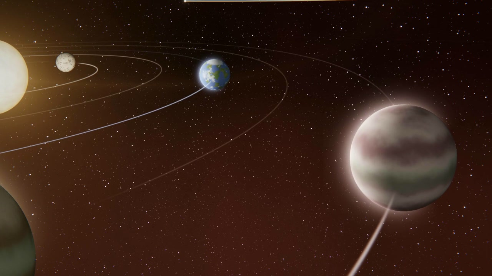

# muzak visualizer

A music visualizer that flies a camera through a small constellation of star
systems while the song plays. Suns, planets, ships and a fluid nebula all react
to the music. Written in one C++ file with SDL2 and OpenGL.

It plays live in a window or renders straight to an MP4.

## What reacts to what

- The song is split into five frequency bands; each of the outer stars follows
  one, and its planets orbit faster when its band is busy.
- The centre star sends out a ring for each note of the song's low synth line.
  With separated stems (see below) the drums are kept out of it, so the rings
  follow the tune and not the hi-hats.
- Drops are found ahead of time, and the camera times a swoop across the
  constellation to land on each one.
- Each song gets its own constellation and palette, seeded from its filename.

Brightness is driven only by smoothed signals: nothing flashes or strobes, and
the camera never shakes to the beat.

## Building

Needs a C++17 compiler, SDL2 and the `ffmpeg` command. Developed on macOS
(OpenGL 3.3 core); it has not been built on Linux or Windows.

    brew install sdl2 ffmpeg
    make

## Using it

    make run SONG=path/to/song.mp3        # play live
    make video SONG=path/to/song.mp3      # song.mp4, 1920x1080 at 60 fps
    make vertical SONG=path/to/song.mp3   # song-vertical.mp4, 1080x1920

Or run `./viz` directly; `./viz` with no arguments lists the options
(`--size`, `--fps`, `--start`, `--duration`, `--palette`, `--ships`,
`--pulse`, `--fullscreen`).

Live keys: space pauses, left/right seek 5 s, `n` next song, `c` next palette,
`f` fullscreen, `q` or escape quits.

## Stems (optional, recommended)

    make stems SONG=path/to/song.mp3

runs [Demucs](https://github.com/adefossez/demucs) through `uv` and writes
`stems/htdemucs/<song>/{drums,bass,other,vocals}.wav` next to the song. When
those exist the centre star pulses to the `synth` source (bass and other stems,
low register). Without them it falls back to the full mix.

    make pulses SONG=path/to/song.mp3     # compare the available pulse sources
    make run SONG=... PULSE=kick          # or melody, drums, hats, bass, synth+kick, ...

## Licence

MIT. See [LICENSE](LICENSE).
